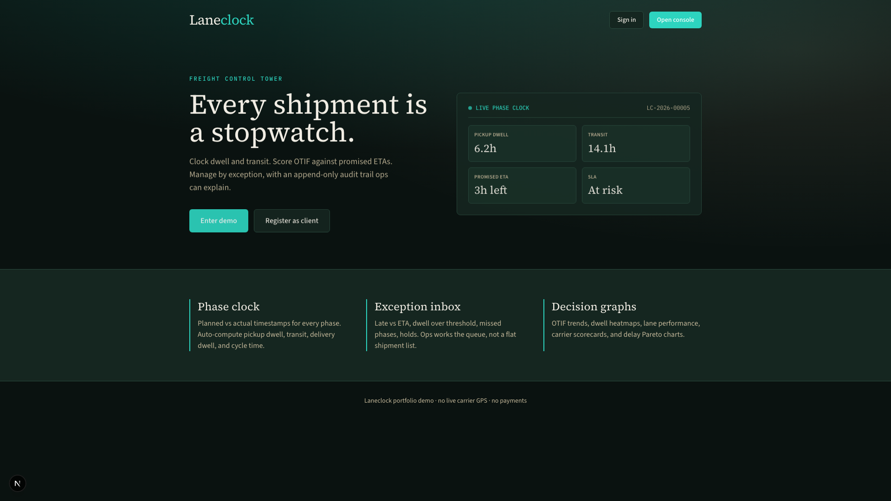
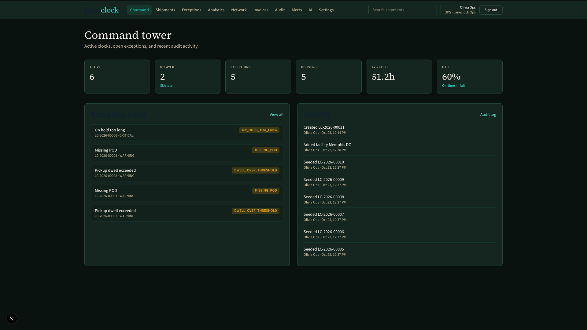
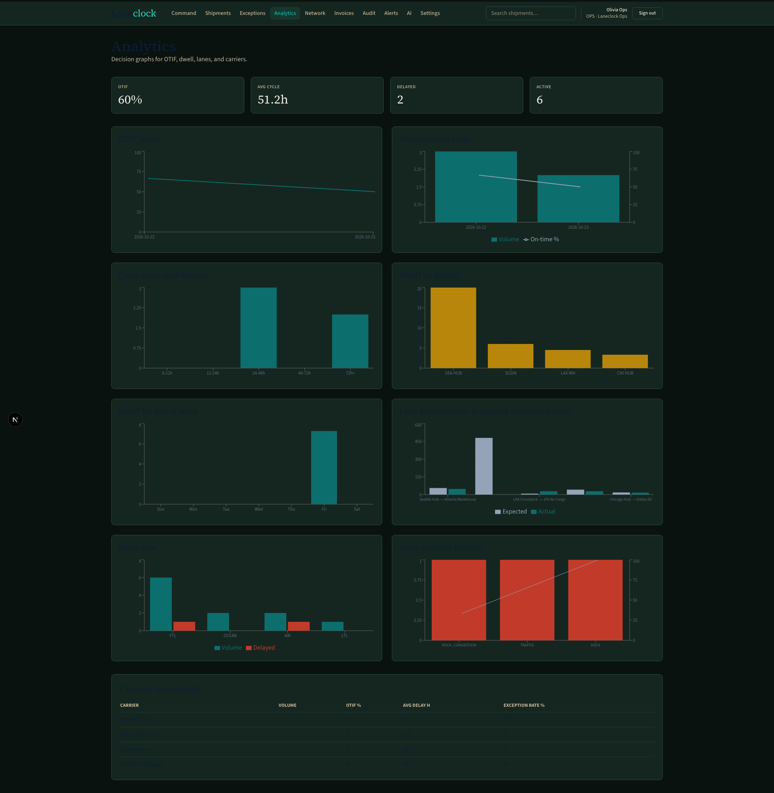
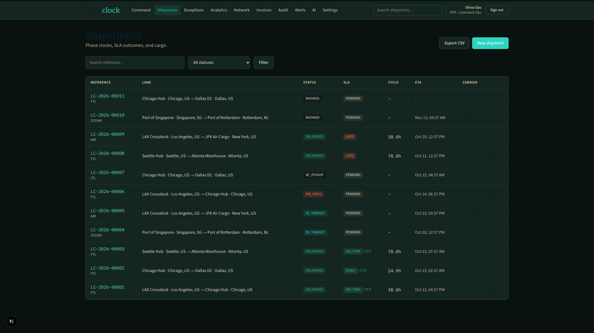
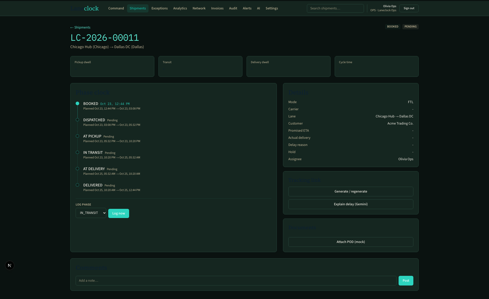
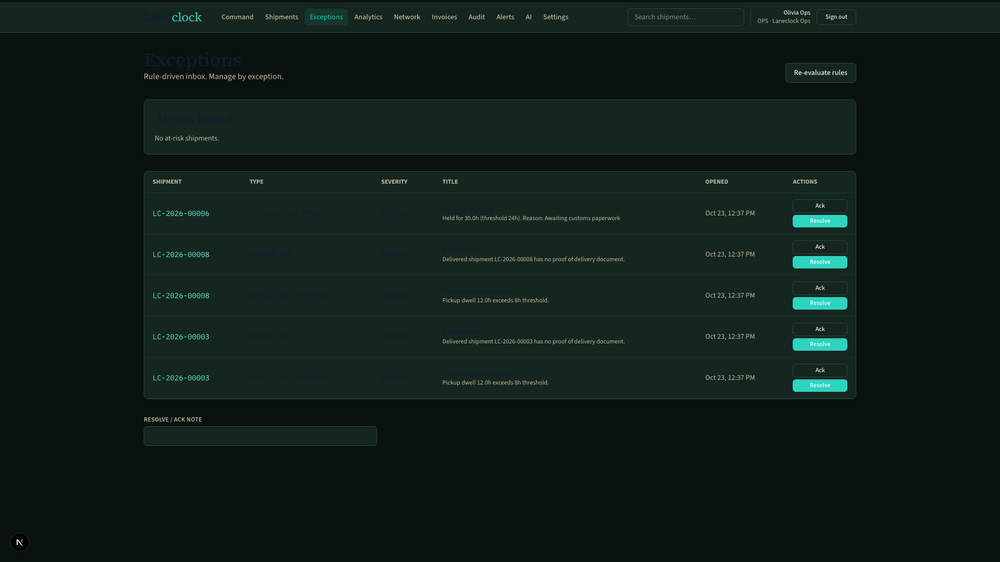
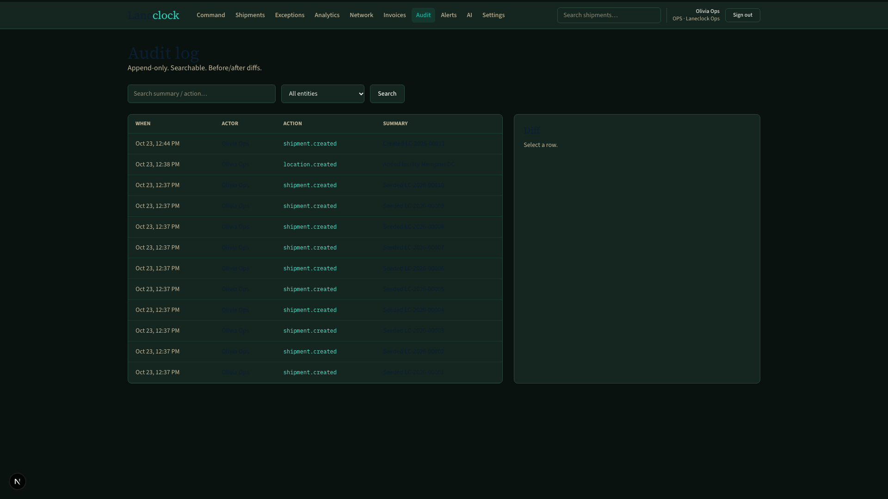
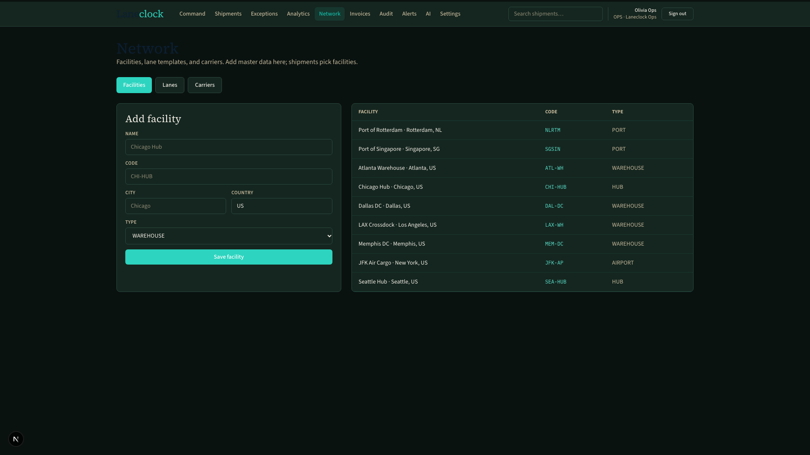
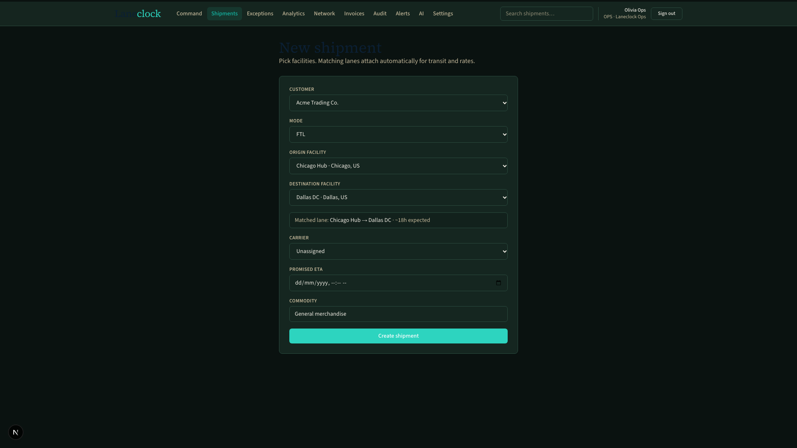

# Laneclock: Freight Control Tower

**Every shipment is a stopwatch.** Clock dwell and transit, score OTIF against promised ETAs, manage by exception, and keep an append-only audit trail.

Portfolio demo: not a real carrier network. GPS / email / payments are mocked. Gemini AI is optional.

## Stack

- **Web:** Next.js 15, TypeScript, Tailwind, Recharts
- **API:** Express + TypeScript
- **DB:** PostgreSQL + Prisma
- **Auth:** BetterAuth (email/password, cookie sessions)
- **Shared:** Zod schemas + SLA/hour math (`@laneclock/shared`)

## Demo accounts

| Email | Password | Role |
|-------|----------|------|
| `ops@laneclock.demo` | `demo1234` | Ops |
| `client@laneclock.demo` | `demo1234` | Client (Acme) |
| `admin@laneclock.demo` | `demo1234` | Admin |

## Quick start

```bash
# 1) Postgres on port 5435 (avoids clashing with other local DBs on 5432)
#    Prefer Podman or Docker:
podman run -d --name laneclock-postgres \
  -e POSTGRES_USER=laneclock -e POSTGRES_PASSWORD=laneclock -e POSTGRES_DB=laneclock \
  -p 5435:5432 docker.io/library/postgres:16-alpine
# or: docker compose up -d

# 2) Env
cp .env.example .env
# Optional: GEMINI_API_KEY=... for AI features

# 3) Install & DB
pnpm install
pnpm --filter @laneclock/shared build
pnpm db:push
pnpm db:seed

# 4) Run
pnpm dev:api   # http://localhost:4000
pnpm dev:web   # http://localhost:3000
```

## Screenshots

| | |
|---|---|
|  |  |
|  |  |
|  |  |
|  |  |

New shipment (facility pickers + auto lane match): 

## 10-minute walkthrough

1. Open `/`: marketing hero (Laneclock brand + phase clock pitch).
2. Sign in as `ops@laneclock.demo` / `demo1234`.
3. **Command**: KPIs, exception peek, activity feed.
4. **Network**: add facilities / lane templates (or use seeded ones).
5. **Shipments**: create a load by picking origin + destination facilities; open a late or in-transit load for the phase clock.
6. Log a phase or generate a **public track** link → open `/track/...` in a private window.
7. **Exceptions**: acknowledge / resolve; **Analytics**: OTIF, dwell, lanes, carriers, Pareto.
8. **Audit**: click a row for before/after JSON.
9. (Optional) **AI**: set `GEMINI_API_KEY`, generate weekly brief / delay explainer.

## What is mocked vs real

| Concern | Approach |
|---------|----------|
| Carrier GPS | Ops (or seed) logs phase timestamps |
| Email | In-app notifications |
| Payments | Mock invoices + variance flags: no Stripe |
| AI | Gemini if `GEMINI_API_KEY` set; otherwise disabled |

## Repo layout

```
apps/web          Next.js console + marketing
apps/api          Express + Prisma + BetterAuth
packages/shared   Zod + SLA / hour helpers
```

## Thesis (interview one-liner)

Laneclock is a freight control tower that treats every shipment as a stopwatch: we clock dwell and transit, score OTIF against promised ETAs, surface exceptions before they explode, and keep an append-only audit trail so ops can explain every change.

## Tests

```bash
pnpm test   # Vitest: hour math, SLA outcomes, phase metrics
```
